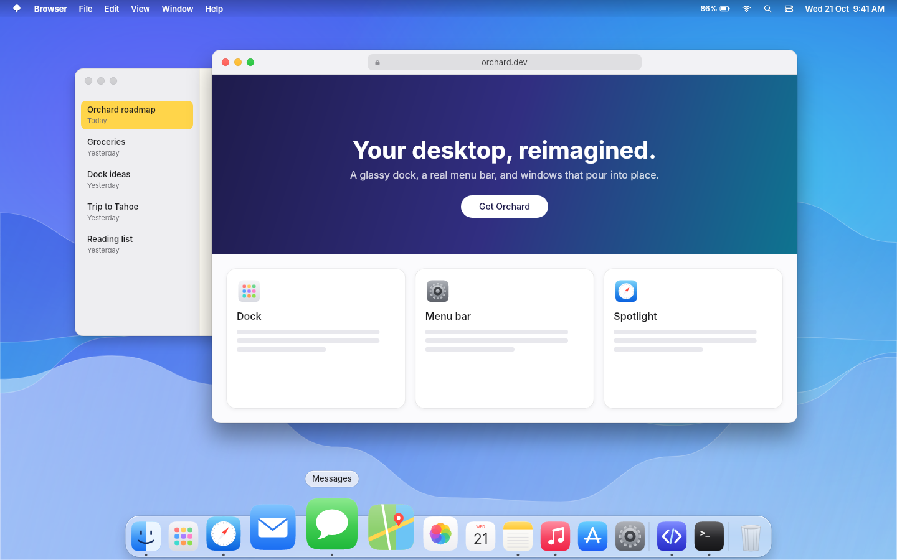
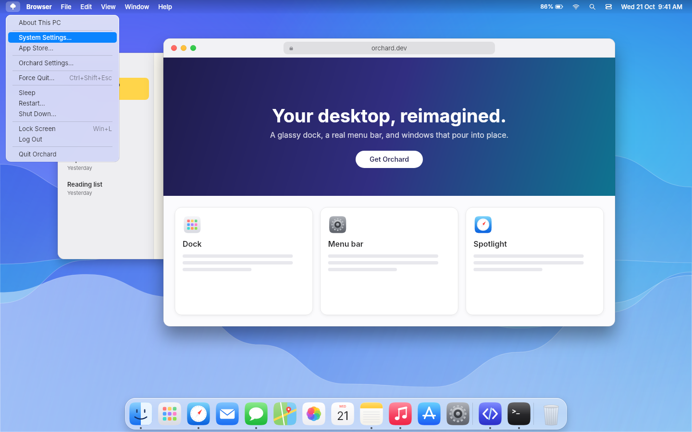
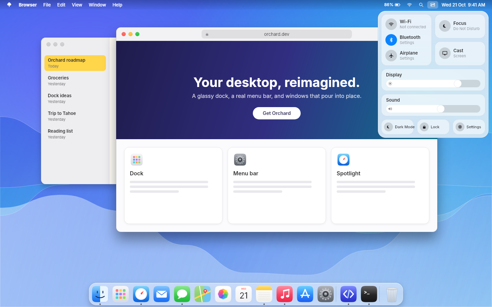
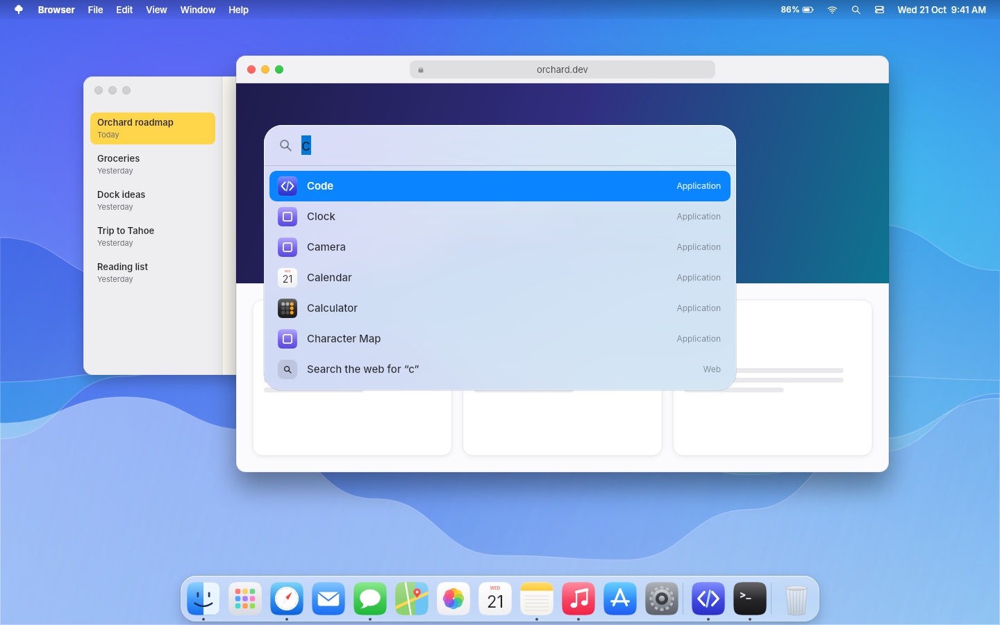
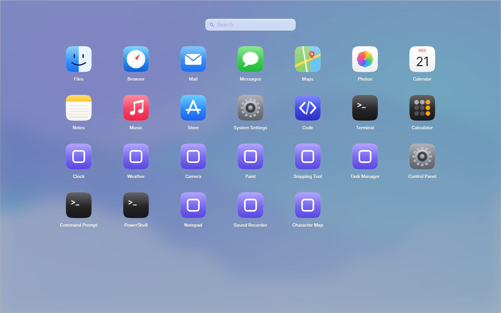
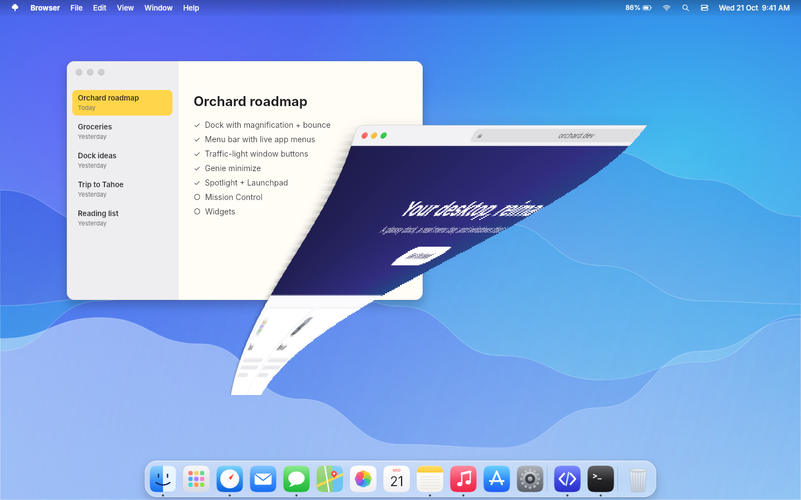
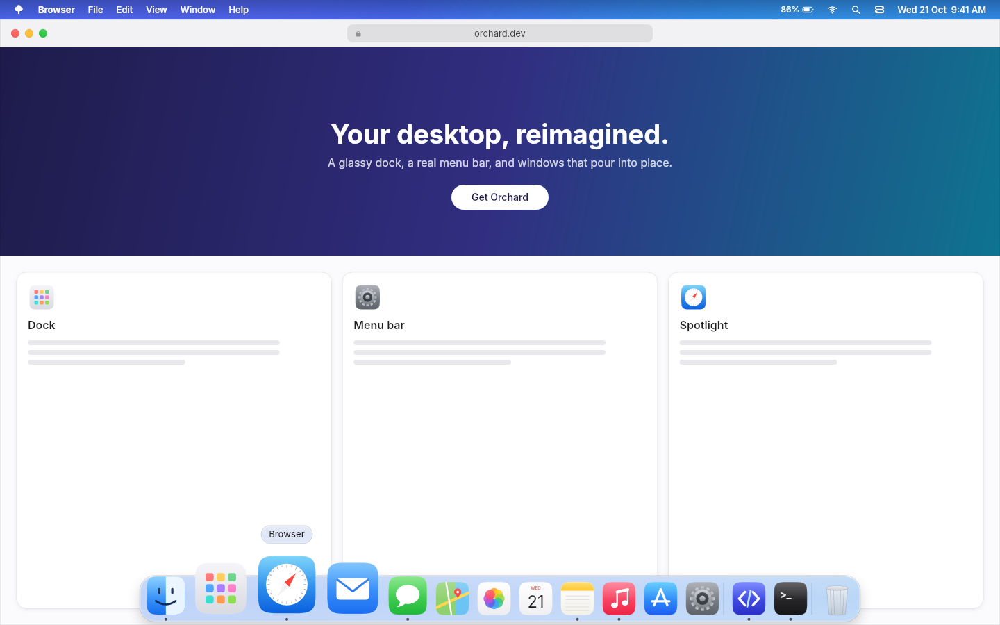

# Orchard

A macOS-style desktop shell for **Windows 10 and 11**. It doesn't replace Windows. It sits on top and gives you
the feel of a Mac desktop: a glass dock with magnification, a real menu bar, red/yellow/green window buttons,
the genie minimize effect, Spotlight, Launchpad and Control Center.



| | |
|---|---|
|  |  |
|  |  |
|  |  |

> These screenshots come from Orchard's own UI controls, rendered headlessly by `tools/Orchard.Screenshots` over a
> simulated desktop. On a real PC, the same controls sit over your actual apps.

## Features

| | What it does |
|---|---|
| **Dock** | Glass shelf with a magnification wave, launch bounce, running-app dots, hover labels, pinned apps + running apps + Recycle Bin, and a right-click menu (Keep in Dock, Show in Explorer, Quit, the app's windows). Real app icons are pulled at 256 px. |
| **Auto-hide** | The dock slides away when a window is maximized, fullscreen or dragged over it. Rest the pointer on the bottom edge to bring it back. In fullscreen the menu bar slides up and returns when you touch the top edge. |
| **Windows taskbar** | Hidden while Orchard runs, so its reveal zone doesn't fight the dock's. It's **always restored**: on exit, by a watchdog process if Orchard crashes or is killed, and on the next launch if the PC lost power. |
| **Menu bar** | Logo menu (About, Settings, Force Quit, Sleep/Restart/Shut Down, Lock), the **bold name of the app in front**, then File / Edit / View / Window / Help. Menu items send the standard shortcut (Copy → Ctrl+C) to the front app, so they work in almost any program. With a menu open, sliding along the bar switches menus. On the right: battery, Wi-Fi, Spotlight, Control Center, clock. It reserves its strip so maximized windows stop below it. |
| **Window buttons** | Close / minimize / zoom buttons follow the active window. Hovering shows the ×, − and zoom symbols. Minimize plays the genie effect into the app's dock icon, and clicking the icon pours the window back out. |
| **Spotlight** | **Alt+Space**. Fuzzy search over Start-menu apps (try `vsc`), inline maths (`(1440*900)/2`) and web search. |
| **Launchpad** | Full-screen, paged grid of every installed app, with search. |
| **Control Center** | Real volume and laptop-brightness sliders, a real dark mode toggle, and Lock. Wi-Fi, Bluetooth, Airplane, Focus and Cast open the matching Settings page, because Windows doesn't let normal apps flip those radios. |
| **Glass look** | The compositor blurs whatever is behind each surface, with a tinted, rim-lit glass layer painted over it. Light and dark appearance are both supported. |

## Run it

**Download:** the `build` GitHub Action publishes a self-contained `Orchard.exe` (artifact **Orchard-win-x64**).
Nothing to install: double-click it. To start it with Windows, put a shortcut in `shell:startup`.

**Build from source:**

```powershell
dotnet run --project src/Orchard               # the real shell, on Windows
dotnet run --project src/Orchard -- --preview  # the whole shell inside one window, safe to try (any OS)
```

**Keyboard**

| Keys | Action |
|---|---|
| Alt+Space | Spotlight |
| Ctrl+Alt+Shift+O | Quit Orchard immediately (emergency exit) |
| Esc | Close Spotlight / Launchpad / menus |

If anything ever looks wrong, `Orchard.exe --restore` puts the taskbar and the Windows minimize animation back.
Rebooting also resets the animation setting, because Orchard never writes it to your profile.

## Settings

Use **logo menu → Orchard Settings…**, or edit `%APPDATA%\Orchard\settings.json` and restart Orchard:

```jsonc
{
  "Dock": "HideWhenOverlapped",        // AlwaysShow | HideWhenOverlapped | AlwaysAutoHide
  "MenuBar": "HideInFullscreen",       // AlwaysShow | HideInFullscreen | AlwaysAutoHide
  "IconSize": 54,
  "Magnification": true,
  "MagnifiedScale": 1.75,
  "MinimizeEffect": "Genie",           // Genie | Scale | System
  "TrafficLights": true,
  "TrafficLightExclusions": [],        // e.g. ["chrome.exe"] to keep an app's own buttons in that spot
  "HideWindowsTaskbar": true,
  "DarkMode": false,
  "Pinned": [ { "Name": "Notepad", "Target": "notepad.exe" } ]
}
```

## How it works

```
src/Orchard
  Controls/   DockControl, MenuBarView, MenuPanel, TrafficLights, SpotlightView, LaunchpadView, ControlCenterView
  Rendering/  Glass material, procedural icons and wallpaper, symbols, genie strip renderer
  Services/   pure logic: dock maths, auto-hide state machine, fuzzy search, calculator   (unit tested)
  Platform/   IShellPlatform  ← WindowsPlatform (Win32)  |  PreviewPlatform (fake desktop)
  Shell/      ShellHost: one borderless window per surface on the real desktop
  Preview/    DesktopScene: every surface composed in one window, for --preview and screenshots
```

* **Built with** C# / .NET 8 and [Avalonia](https://avaloniaui.net/) using Skia GPU rendering. Shell surfaces are
  custom drawn, so each frame of the dock's magnification wave is one cheap render pass.
* **Click-through and blur:** every shell window is clipped to the shapes it actually paints (`SetWindowRgn`). Outside
  the shelf and the magnified icons, clicks go to the window underneath, and the compositor blur (`ACCENT_ENABLE_BLURBEHIND`)
  covers exactly the glass.
* **Window tracking** uses `SetWinEventHook` (foreground, move/resize, create/destroy, cloak), applies Alt+Tab's
  filtering rules, and unwraps UWP windows from `ApplicationFrameHost`.
* **Genie:** the window is captured with `PrintWindow(PW_RENDERFULLCONTENT)` and Windows' own minimize animation is
  switched off. The snapshot is then cut into 260 strips that pinch into the dock icon along a smootherstep funnel.
* **Window buttons** are a tiny overlay window *owned* by the active app's window, so they stay directly above it in
  the z-order without being always-on-top.

## Tests and screenshots

```bash
dotnet test tests/Orchard.Tests                 # dock maths, auto-hide timing, search, calculator, settings
dotnet run --project tools/Orchard.Screenshots  # regenerates docs/screenshots/*.png (headless, any OS)
```

## Known limitations

* **System tray icons** (Discord, OneDrive, …) aren't mirrored into the menu bar yet, so they're hidden along with
  the taskbar. Set `"HideWindowsTaskbar": false` if you rely on them.
* The window buttons are **overlaid** on each app's title bar. The app's own Windows buttons are still on the right,
  and in apps that draw something at the top-left (browser tabs) the overlay covers a little of it. Use
  `TrafficLightExclusions` for those apps.
* Genie only runs when you minimize through Orchard (the yellow button, Window ▸ Minimize, App ▸ Hide). Win+↓ and the
  app's own minimize button use a plain minimize.
* Wi-Fi and Bluetooth tiles open Settings rather than toggling the radio.
* Primary monitor only for now.
* Not done yet: Mission Control, widgets, notification center.

## Legal

Orchard is an independent project. It is not affiliated with or endorsed by Apple. It ships no Apple assets: the icons,
logo, symbols and wallpaper are original procedural drawings. The UI font is [Inter](https://github.com/rsms/inter),
used under the SIL Open Font License (`src/Orchard/Assets/Fonts/OFL.txt`). "macOS" is a trademark of Apple Inc.
